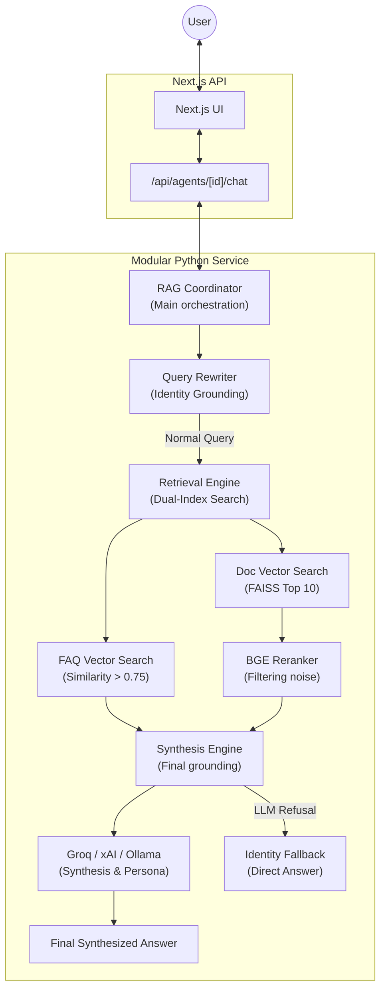

# Production Modular Agent Architecture

This document defines the modular **RAG-First** architecture for the MedTrust Chatbot, designed for scalability and high-fidelity grounding.

## 🏗️ System Overview

The system transitions from a monolithic RAG flow to a **Coordinator Pattern**, where specialized logic handles classification, retrieval, and synthesis.

---

## 🔄 Execution Flow

### 1. Query Normalization & Rewriting
- Every query is processed to determine identity context and handle multi-turn history.
- **Identity Grounding** ensures "Who are you?" is interpreted correctly for the specific company (e.g., MedTrust).

### 2. Dual-Index Retrieval
- **High-Priority (FAQ)**: Manual Q&A pairs are searched with a strict threshold (>0.75). If a high-confidence match is found, it is prioritized.
- **Discovery (Docs)**: Scraped documentation is searched as a fall-through or for broader context.

### 3. Re-ranking
- Uses `BAAI/bge-reranker-base` to ensure the most relevant fragments are prioritized for the LLM, reducing hallucination risk from noisy scraped data.

### 4. Grounded Synthesis
- The **Synthesis Engine** constructs a professional, persona-driven prompt.
- Includes a **Grounded Fallback** mechanism: if the LLM refuses to answer or is offline, the system extracts a direct definition from the best retrieved chunk.

---

## 🛠️ Technology Stack

- **Coordinator**: Python (FastAPI).
- **LLM Providers**: 
  - **Groq**: Llama-3.3-70b-versatile.
  - **xAI**: Grok-3.
  - **Ollama**: Local fallback (Llama-3).
- **Embeddings**: BAAI/bge-base-en-v1.5.
- **Reranking**: BAAI/bge-reranker-base.
- **Vector DB**: FAISS.
