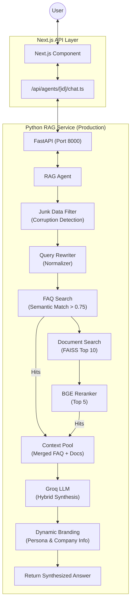

# Production RAG-First Architecture

This document defines the production-grade **RAG-First** architecture for the MedTrust Chatbot, focusing on accuracy, semantic understanding, and grounding.

## 🏗️ System Overview

The system uses a **Dual-Index** approach to separate manual knowledge (FAQs) from scraped documents, ensuring high-confidence answers for common questions.

---

## 🔄 Production Request Flow

### 1. Query Normalization
- User queries are rewritten to improve semantic hit rates (e.g., adding context words for locations).

### 2. FAQ Semantic Priority (Step 2)
- **Search**: Scans the specific `faq` vector index.
- **Goal**: Provides immediate, high-fidelity answers for manual Q&A pairs.
- **Threshold**: **> 75% similarity**. If found, returns immediately.

### 3. Document RAG (Fall-through)
- **Top 10 Retrieval**: Pulls the most relevant chunks from the scraped website index.
- **Reranking**: Uses BGE Cross-Encoder to select the top 5 most relevant fragments.
- **Synthesis**: Top 3 chunks are sent to Groq (Llama 3.3) with a strict context-bound prompt.

### 4. Standardized Confidence (>0.45)
- All retrieval is governed by a consistent similarity metric. 
- Results below 45% are rejected to prevent hallucinations.

---

## 🛠️ Technology Stack

- **Frontend**: Next.js (App Router), Tailwind CSS.
- **AI Service**: Python, FastAPI.
- **Vector Search**: FAISS (Dual-index: `docs` vs `faq`).
- **Embeddings**: BAAI/bge-base-en-v1.5.
- **Re-ranking**: BAAI/bge-reranker-base.
- **LLM Provider**: Groq (Llama-3.3-70b-versatile).
- **Strategy**: Semantic-first, Zero-keyword fallback.
